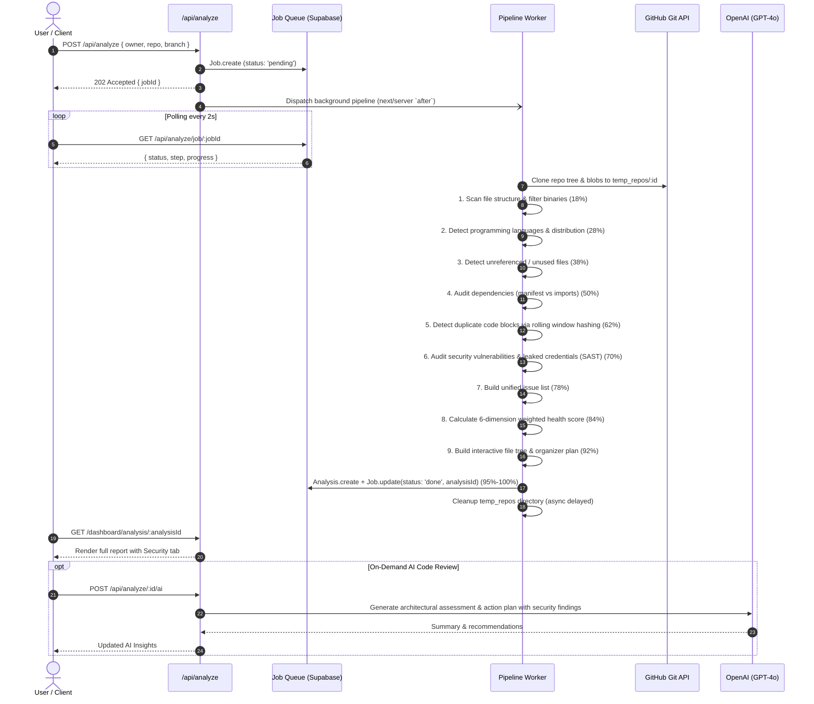
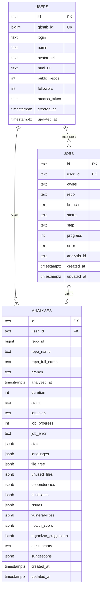

# RepoMedic System Architecture

RepoMedic is an AI-powered code quality, security vulnerability, and repository health analysis platform. It combines static AST/regex scanning, SAST vulnerability auditing, dependency analysis, duplicate code detection, and LLM-driven architectural reviews (OpenAI GPT-4o) on cloned GitHub repositories, backed by **Supabase PostgreSQL** and **NextAuth**.

---

## 1. High-Level Architecture

```mermaid
graph TD
    Client["Client Browser (Next.js 16 + React 19)"] <--> |HTTPS / SSR & App Router APIs| NextApp["Next.js Server & Route Handlers"]
    
    subgraph "External Cloud Services"
        GitHub["GitHub OAuth & Git Blobs API"]
        OpenAI["OpenAI API (GPT-4o)"]
        Supabase["Supabase PostgreSQL (Pooler: 5432)"]
    end
    
    subgraph "Analysis Engine Pipeline (src/lib/analyzer.ts)"
        GitEngine["Clone Engine (Memory Buffer / Ephemeral)"]
        FileTreeGen["File Tree & Language Detector"]
        UnusedScanner["Dead Code & Unused File Scanner"]
        DepAuditor["Dependency Hygiene Auditor"]
        DupeDetector["Code Duplication Block Scanner"]
        VulnScanner["SAST Vulnerability & Secret Leak Scanner"]
        ScoreEngine["Multi-Dimensional Health Score Engine"]
    end

    NextApp <--> |OAuth Session & Tree Clones| GitHub
    NextApp <--> |Code Review Prompt| OpenAI
    NextApp <--> |Pooled SQL (pg Pool)| Supabase
    NextApp --> GitEngine
    GitEngine --> FileTreeGen
    FileTreeGen --> UnusedScanner
    UnusedScanner --> DepAuditor
    DepAuditor --> DupeDetector
    DupeDetector --> VulnScanner
    VulnScanner --> ScoreEngine
```

---

## 2. Core Components

### 2.1. Presentation Layer (Next.js 16 App Router & React 19)
- **Landing Page ([src/app/page.tsx](file:///c:/Users/Pushkar%20Mhatre/Desktop/Work/repomedic-ai/src/app/page.tsx))**: Authentication gate, platform value proposition, and GitHub sign-in trigger.
- **Dashboard ([src/app/dashboard/page.tsx](file:///c:/Users/Pushkar%20Mhatre/Desktop/Work/repomedic-ai/src/app/dashboard/page.tsx))**:
  - Fetches the user's GitHub repositories with their OAuth access token.
  - Triggers asynchronous repository audits.
  - Monitors background jobs with active status polling (`/api/analyze/job/[jobId]`).
- **Analysis View ([src/app/dashboard/analysis/[id]/page.tsx](file:///c:/Users/Pushkar%20Mhatre/Desktop/Work/repomedic-ai/src/app/dashboard/analysis/%5Bid%5D/page.tsx))**:
  - Server-side data fetching with type-safe hydration.
  - [ResultClient.tsx](file:///c:/Users/Pushkar%20Mhatre/Desktop/Work/repomedic-ai/src/app/dashboard/analysis/%5Bid%5D/ResultClient.tsx): Interactive multi-tab breakdown:
    - **Overview**: Overall health score ring, 6-dimension breakdown chart, language distribution, and quick metric cards (including Vulnerabilities).
    - **Security**: Comprehensive SAST audit with severity filters (`Critical`, `High`, `Medium`, `Low`), masked code snippets, CWE badges, and remediation recommendations.
    - **File Tree**: Visual directory hierarchy with indicators for clean, unused, and duplicate files.
    - **Cleanup**: Downloadable shell script (`cleanup_<repo>.sh`) to delete orphaned files automatically.
    - **Dependencies**: Used vs. unused dependency audit with version metadata.
    - **Duplicates**: Code block duplication detection with file references and match IDs.
    - **Organizer**: Proposed refactored folder structure tailored to the primary language.
    - **Issues**: Categorized severity breakdown and detailed diagnostic log.
- **History View ([src/app/dashboard/history/page.tsx](file:///c:/Users/Pushkar%20Mhatre/Desktop/Work/repomedic-ai/src/app/dashboard/history/page.tsx))**: Chronological history of past audits with health scores and deletion controls.

---

### 2.2. API & Routing Layer

| Endpoint | Method | Description |
|---|---|---|
| `/api/auth/[...nextauth]` | `GET`, `POST` | NextAuth GitHub OAuth handler and session token lifecycle |
| `/api/analyze` | `POST` | Queues repository analysis job and launches background pipeline via Next.js `after()` |
| `/api/analyze/job/[jobId]` | `GET` | Polling endpoint for job step (`step`) and progress percentage (`progress`) |
| `/api/analyze/[id]` | `GET`, `DELETE` | Retrieves complete analysis report or permanently deletes a report |
| `/api/analyze/[id]/ai` | `POST` | Dispatches on-demand OpenAI GPT-4o contextual architectural review |
| `/api/analyze/history` | `GET` | Lists previous analyses for the authenticated user |

---

### 2.3. Analysis Engine Pipeline ([src/lib/analyzer.ts](file:///c:/Users/Pushkar%20Mhatre/Desktop/Work/repomedic-ai/src/lib/analyzer.ts))

The analysis pipeline processes repositories in sequential, non-blocking steps:



---

## 3. Data Architecture (Supabase / PostgreSQL)

Database connection is established through the **Supabase Connection Pooler** (Session mode on port `5432` / Transaction mode on port `6543`), managed via `pg.Pool` in [src/lib/db.ts](file:///c:/Users/Pushkar%20Mhatre/Desktop/Work/repomedic-ai/src/lib/db.ts).

### 3.1. Entity Relationship Diagram



### 3.2. Data Models & Mapping
- **[User](file:///c:/Users/Pushkar%20Mhatre/Desktop/Work/repomedic-ai/src/lib/models/User.ts)**: Handles GitHub OAuth profiles and stores user credentials and tokens.
- **[Job](file:///c:/Users/Pushkar%20Mhatre/Desktop/Work/repomedic-ai/src/lib/models/Job.ts)**: Manages async job queue states (`pending` ➔ `running` ➔ `done` / `error`).
- **[Analysis](file:///c:/Users/Pushkar%20Mhatre/Desktop/Work/repomedic-ai/src/lib/models/Analysis.ts)**: Stores structured scan metrics, issues, and security vulnerabilities using JSONB columns with a fluent query builder (`.find()`, `.sort()`, `.limit()`, `.lean()`).

---

## 4. Vulnerability & Security Scanner Utility ([src/lib/vulnerabilityScanner.ts](file:///c:/Users/Pushkar%20Mhatre/Desktop/Work/repomedic-ai/src/lib/vulnerabilityScanner.ts))

RepoMedic includes a built-in Static Application Security Testing (SAST) and credential detection engine that audits the codebase line-by-line during the analysis pipeline.

### 4.1. Security Check Categories

| Category | CWE | Severity | Example Patterns Detected |
|---|:---:|:---:|---|
| **Secret Leaks** | CWE-798 | Critical / High | OpenAI keys (`sk-proj-...`), GitHub PATs (`ghp_...`, `github_pat_...`), AWS Access/Secret keys, Supabase Service Role keys, Stripe keys, Private RSA/SSH keys, Hardcoded database URIs with credentials |
| **Command Injection** | CWE-78 | Critical | Dynamic template interpolation in Node.js `exec()` / `execSync()`, Python `os.system()` and `subprocess(..., shell=True)` |
| **SQL Injection** | CWE-89 | High | Unescaped string concatenation in raw SQL queries (`SELECT ... + id` or template strings) |
| **Code Execution** | CWE-95 | Critical / High | `eval()`, `new Function()`, Python `exec()` |
| **Insecure Deserialization** | CWE-502 | Critical / High | Python `pickle.loads()`, unconstrained `yaml.load()` without SafeLoader, `node-serialize` |
| **Cross-Site Scripting (XSS)** | CWE-79 | Medium | React `dangerouslySetInnerHTML`, raw `innerHTML` assignments, `document.write()` |
| **Path Traversal** | CWE-22 | High | Direct use of request parameters in `fs.readFile()` without path normalization |
| **Cryptographic Weaknesses** | CWE-327 / CWE-338 | Medium | Broken hashes (MD5 / SHA-1) for security signatures, `Math.random()` used for token generation |
| **Security Misconfiguration** | CWE-295 / CWE-319 | Medium / Low | `rejectUnauthorized: false` (SSL bypass), unencrypted remote HTTP API endpoints |
| **Dependency Vulnerabilities** | CWE-1104 / CWE-506 | Critical / High | Known compromised or deprecated packages (`node-serialize`, `event-stream`, `flatmap-stream`, `request`) |

### 4.2. Secret Masking & Safe Reporting
- When hardcoded secrets are detected, the analyzer automatically masks the sensitive tokens (e.g., `sk-proj-ab****456`) so sensitive production credentials are never revealed in plain text in logs or client-rendered dashboards.
- Placeholders, mock templates (`your-api-key`, `sk-xxx`), and test fixtures are automatically filtered to prevent false alarms.

---

## 5. Health Score Calculation Methodology

The overall health score ($0 - 100$) is dynamically computed across six key dimensions in [src/lib/analyzer.ts](file:///c:/Users/Pushkar%20Mhatre/Desktop/Work/repomedic-ai/src/lib/analyzer.ts):

| Dimension | Weight | Description |
|---|:---:|---|
| **Security & Vulnerabilities** | 25% | Deductions for Critical (-30), High (-15), Medium (-6), and Low (-2) vulnerabilities |
| **File Cleanliness** | 20% | Penalty for orphaned, temporary, or unimported files |
| **Dependency Hygiene** | 20% | Percentage of declared dependencies actively utilized |
| **Duplicate Code** | 15% | Ratio of duplicate code blocks vs total file lines |
| **Architecture & Structure** | 10% | Presence of `.gitignore`, testing directory, and standard layout |
| **Documentation** | 10% | Presence and quality of README and documentation coverage |

---

## 6. Security, Isolation & Production Deployments

- **Token Security**: GitHub personal access tokens are stored in the database and utilized solely for user-authorized Git cloning and repo listing.
- **Ephemeral Clones**: Cloned repositories are isolated in `temp_repos/<uuid>` and deleted with `rimraf` after scanning completes.
- **Database Safety**: All SQL operations use parameterized queries (`$1, $2, ...`) against Supabase to eliminate SQL injection risks.
- **Environment Isolation**: Production credentials and secrets are managed via environment variables (`DATABASE_URL`, `NEXTAUTH_SECRET`, `GITHUB_CLIENT_SECRET`, `OPENAI_API_KEY`).
- **Connection Pooler**: Connects to Supabase via IPv4-compatible connection poolers (`aws-0-<region>.pooler.supabase.com:5432`) to ensure high availability across serverless environments.

---

## 7. Project Structure

```
repomedic-ai/
├── archi.md                  # Comprehensive system architecture documentation
├── README.md                 # Project overview and setup instructions
├── package.json              # Project dependencies and npm scripts
├── scripts/
│   └── migrate.js            # Supabase schema migration runner
└── src/
    ├── app/
    │   ├── api/
    │   │   ├── analyze/
    │   │   │   ├── [id]/
    │   │   │   │   ├── ai/   # GPT-4o on-demand contextual audit
    │   │   │   │   └── route.ts # Get & delete analysis reports
    │   │   │   ├── history/  # User analysis history endpoint
    │   │   │   ├── job/[jobId]/ # Asynchronous job polling endpoint
    │   │   │   └── route.ts  # Queue analysis job
    │   │   └── auth/         # NextAuth route handler ([...nextauth])
    │   ├── dashboard/
    │   │   ├── analysis/[id]/# Report view with interactive tabs
    │   │   ├── history/      # Historical audits list
    │   │   └── page.tsx      # Main dashboard & repo selector
    │   ├── layout.tsx        # App root layout & providers
    │   └── page.tsx          # Public landing page
    ├── components/
    │   ├── FileTree.tsx      # Interactive hierarchical file tree
    │   ├── Navbar.tsx        # Navigation and session controls
    │   ├── RepoCard.tsx      # Repository selection card
    │   └── ScoreChart.tsx    # Health ring, breakdown bars, and language pie
    └── lib/
        ├── analyzer.ts       # Core analysis pipeline engine
        ├── auth.ts           # NextAuth GitHub OAuth configuration
        ├── db.ts             # Supabase pooled PostgreSQL client
        ├── schema.sql        # Database table definitions & indexes
        ├── vulnerabilityScanner.ts # SAST & secret audit engine
        └── models/
            ├── Analysis.ts   # Analysis model with fluent query builder
            ├── Job.ts        # Job model for queue progress
            └── User.ts       # User model for OAuth profiles
```
