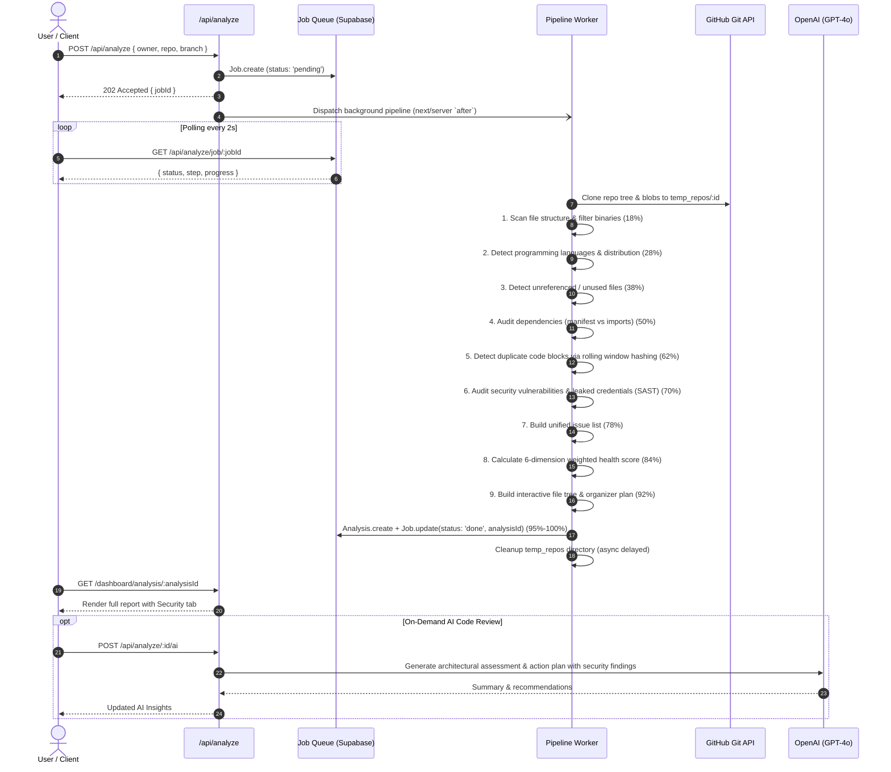
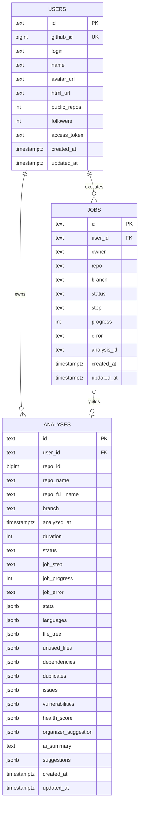

# RepoMedic System Architecture

RepoMedic is an AI-powered code quality, security vulnerability, and repository health analysis platform. It combines static AST/regex scanning, SAST vulnerability auditing, dependency analysis, duplicate code detection, and LLM-driven architectural reviews (OpenAI GPT-4o) on cloned GitHub repositories, backed by **Supabase PostgreSQL** and **NextAuth**.

---

## 1. High-Level Architecture

```mermaid
graph TD
    Client["Client Browser (Next.js 16 + React 19)"] <--> |HTTPS / SSR & App Router APIs| NextApp["Next.js Server & Route Handlers"]
    
    subgraph "External Cloud Services"
        GitHub["GitHub OAuth & Git Blobs API"]
        OpenAI["OpenAI API (GPT-4o)"]
        Supabase["Supabase PostgreSQL (Pooler: 5432)"]
    end
    
    subgraph "Analysis Engine Pipeline (src/lib/analyzer.ts)"
        GitEngine["Clone Engine (Memory Buffer / Ephemeral)"]
        FileTreeGen["File Tree & Language Detector"]
        UnusedScanner["Dead Code & Unused File Scanner"]
        DepAuditor["Dependency Hygiene Auditor"]
        DupeDetector["Code Duplication Block Scanner"]
        VulnScanner["SAST Vulnerability & Secret Leak Scanner"]
        ScoreEngine["Multi-Dimensional Health Score Engine"]
    end

    NextApp <--> |OAuth Session & Tree Clones| GitHub
    NextApp <--> |Code Review Prompt| OpenAI
    NextApp <--> |Pooled SQL (pg Pool)| Supabase
    NextApp --> GitEngine
    GitEngine --> FileTreeGen
    FileTreeGen --> UnusedScanner
    UnusedScanner --> DepAuditor
    DepAuditor --> DupeDetector
    DupeDetector --> VulnScanner
    VulnScanner --> ScoreEngine
```

---

## 2. Core Components

### 2.1. Presentation Layer (Next.js 16 App Router & React 19)
- **Landing Page ([src/app/page.tsx](file:///c:/Users/Pushkar%20Mhatre/Desktop/Work/repomedic-ai/src/app/page.tsx))**: Authentication gate, platform value proposition, and GitHub sign-in trigger.
- **Dashboard ([src/app/dashboard/page.tsx](file:///c:/Users/Pushkar%20Mhatre/Desktop/Work/repomedic-ai/src/app/dashboard/page.tsx))**:
  - Fetches the user's GitHub repositories with their OAuth access token.
  - Triggers asynchronous repository audits.
  - Monitors background jobs with active status polling (`/api/analyze/job/[jobId]`).
- **Analysis View ([src/app/dashboard/analysis/[id]/page.tsx](file:///c:/Users/Pushkar%20Mhatre/Desktop/Work/repomedic-ai/src/app/dashboard/analysis/%5Bid%5D/page.tsx))**:
  - Server-side data fetching with type-safe hydration.
  - [ResultClient.tsx](file:///c:/Users/Pushkar%20Mhatre/Desktop/Work/repomedic-ai/src/app/dashboard/analysis/%5Bid%5D/ResultClient.tsx): Interactive multi-tab breakdown:
    - **Overview**: Overall health score ring, 6-dimension breakdown chart, language distribution, and quick metric cards (including Vulnerabilities).
    - **Security**: Comprehensive SAST audit with severity filters (`Critical`, `High`, `Medium`, `Low`), masked code snippets, CWE badges, and remediation recommendations.
    - **File Tree**: Visual directory hierarchy with indicators for clean, unused, and duplicate files.
    - **Cleanup**: Downloadable shell script (`cleanup_<repo>.sh`) to delete orphaned files automatically.
    - **Dependencies**: Used vs. unused dependency audit with version metadata.
    - **Duplicates**: Code block duplication detection with file references and match IDs.
    - **Organizer**: Proposed refactored folder structure tailored to the primary language.
    - **Issues**: Categorized severity breakdown and detailed diagnostic log.
- **History View ([src/app/dashboard/history/page.tsx](file:///c:/Users/Pushkar%20Mhatre/Desktop/Work/repomedic-ai/src/app/dashboard/history/page.tsx))**: Chronological history of past audits with health scores and deletion controls.

---

### 2.2. API & Routing Layer

| Endpoint | Method | Description |
|---|---|---|
| `/api/auth/[...nextauth]` | `GET`, `POST` | NextAuth GitHub OAuth handler and session token lifecycle |
| `/api/analyze` | `POST` | Queues repository analysis job and launches background pipeline via Next.js `after()` |
| `/api/analyze/job/[jobId]` | `GET` | Polling endpoint for job step (`step`) and progress percentage (`progress`) |
| `/api/analyze/[id]` | `GET`, `DELETE` | Retrieves complete analysis report or permanently deletes a report |
| `/api/analyze/[id]/ai` | `POST` | Dispatches on-demand OpenAI GPT-4o contextual architectural review |
| `/api/analyze/history` | `GET` | Lists previous analyses for the authenticated user |

---

### 2.3. Analysis Engine Pipeline ([src/lib/analyzer.ts](file:///c:/Users/Pushkar%20Mhatre/Desktop/Work/repomedic-ai/src/lib/analyzer.ts))

The analysis pipeline processes repositories in sequential, non-blocking steps:



---

## 3. Data Architecture (Supabase / PostgreSQL)

Database connection is established through the **Supabase Connection Pooler** (Session mode on port `5432` / Transaction mode on port `6543`), managed via `pg.Pool` in [src/lib/db.ts](file:///c:/Users/Pushkar%20Mhatre/Desktop/Work/repomedic-ai/src/lib/db.ts).

### 3.1. Entity Relationship Diagram



### 3.2. Data Models & Mapping
- **[User](file:///c:/Users/Pushkar%20Mhatre/Desktop/Work/repomedic-ai/src/lib/models/User.ts)**: Handles GitHub OAuth profiles and stores user credentials and tokens.
- **[Job](file:///c:/Users/Pushkar%20Mhatre/Desktop/Work/repomedic-ai/src/lib/models/Job.ts)**: Manages async job queue states (`pending` ➔ `running` ➔ `done` / `error`).
- **[Analysis](file:///c:/Users/Pushkar%20Mhatre/Desktop/Work/repomedic-ai/src/lib/models/Analysis.ts)**: Stores structured scan metrics, issues, and security vulnerabilities using JSONB columns with a fluent query builder (`.find()`, `.sort()`, `.limit()`, `.lean()`).

---

## 4. Complex Vulnerability & Security Scanner Utility ([src/lib/vulnerabilityScanner.ts](file:///c:/Users/Pushkar%20Mhatre/Desktop/Work/repomedic-ai/src/lib/vulnerabilityScanner.ts))

RepoMedic features an enterprise-grade Static Application Security Testing (SAST) engine designed for complex codebases. It combines deep regex signatures, AST taint heuristics, OWASP Top 10 taxonomies, multi-line contextual capture, and multi-manifest package dependency CVE auditing.

### 4.1. Multi-Paradigm Analysis Pipeline
The scanner executes across five synchronized detection phases to uncover both surface-level and deep architectural flaws:

1. **Phase 1: Line-by-Line SAST Engine**:
   - Evaluates high-precision security rules against every active line of code without early exit shortcuts (`break` removed).
   - Detects leaked API keys, tokens, hardcoded passwords, dangerous function invocations, and crypto weaknesses.
   - Masks detected credentials (e.g. `sk-proj-ab****456`) before persistence or UI rendering.

2. **Phase 2: Multi-Line Sliding Pattern Scanning**:
   - Inspects statements spanning multiple line breaks (e.g. multi-line SQL strings, multi-line command calls, formatted JSX `dangerouslySetInnerHTML`, and multi-line CORS definitions).
   - Accurately computes exact 1-indexed line numbers using string index tracking.

3. **Phase 3: Heuristic AST Taint Flow Analysis**:
   - **Source Identification**: Detects untrusted user inputs (`req.body`, `req.query`, `req.params`, `request.args`, `request.form`, `sys.argv`, `input()`).
   - **Taint Propagation**: Traces variable assignments downstream across local execution blocks.
   - **Sanitizer Verification**: Verifies whether data passes through sanitizers (`DOMPurify`, `encodeURIComponent`, `shlex.quote`, `parseInt`, `path.basename`).
   - **Sink Interception**: Flags untrusted flows terminating in critical sinks (`exec`, `spawn`, `db.query`, `fetch`, `open`, `eval`) as high-confidence Taint-Flow findings.

4. **Phase 4: Multi-Manifest Supply Chain Auditing**:
   - Scans `package.json` (NPM), `requirements.txt` (Python pip), `Pipfile`, and `go.mod`.
   - Cross-references dependencies against known critical CVE advisories (Log4j, Spring4Shell, Lodash prototype pollution, Axios SSRF, JsonWebToken confusion, Minimist, VM2 sandbox escapes, PyYAML, Pillow).
   - Flags wildcard and unpinned dependency declarations (`*`, `latest`).

5. **Phase 5: Security Posture & Metrics Calculation**:
   - Calculates **Security Score** ($0 - 100$) with severity deductions (Critical: -30, High: -15, Medium: -6, Low: -2).
   - Awards a **Security Grade** (`A+`, `A`, `B`, `C`, `D`, `F`).
   - Computes **Vulnerability Density** (findings per 1,000 LOC).
   - Estimates **Mean Time to Remediate (MTTR)** in developer minutes.

---

### 4.2. Enterprise Security Rule Matrix

| Category | CWE | OWASP / Standard | SANS Top 25 | CVSS | Severity | Vectors Detected & Mitigation |
|---|:---:|:---:|:---:|:---:|:---:|---|
| **Secret & Key Leaks** | CWE-798 | A02:2021 | Yes | 8.5 - 9.8 | Critical / High | OpenAI, Anthropic Claude, HuggingFace, Cohere, GitHub PATs, GitLab tokens, AWS keys, GCP keys, Supabase Service Role keys, Stripe secret/webhook keys, Twilio, SendGrid, Slack bot/webhook tokens, Discord webhooks, NPM & PyPI tokens, Database connection URIs with passwords, RSA/SSH private keys, JWT secrets. Automated credential masking. |
| **Command Injection** | CWE-78 | A03:2021 | Yes (#2) | 8.8 - 9.8 | Critical | Node.js `exec()` / `execSync()` with dynamic string concatenation; `spawn()` with `shell: true`; Python `os.system()`, `subprocess.Popen(shell=True)`. Mitigation: `execFile()` or `subprocess.run(..., shell=False)`. |
| **Taint Data-Flow** | CWE-78 / 89 / 22 / 918 | A03:2021 | Yes | 8.6 - 9.8 | Critical / High | User inputs (`req.query`, `req.body`, `request.args`) tracked propagating into OS commands, SQL queries, file system calls, or HTTP destinations without sanitization. |
| **SQL & NoSQL Injection** | CWE-89 / 943 | A03:2021 | Yes (#3) | 8.8 - 9.5 | Critical / High | Raw SQL string interpolation; ORM raw query bypasses (Prisma `$queryRawUnsafe`, Sequelize `query()`, TypeORM `query()`); MongoDB `$where` clauses with JS expressions. Mitigation: Parameterized bindings (`$1`, `?`). |
| **AI & LLM Security** | CWE-20 / 95 | LLM01 / LLM02 | - | 8.2 - 9.6 | Critical / High | Direct user input concatenation into prompt templates without boundary tags; Insecure execution of model output via `eval()` or child process without containerization. |
| **Code Execution** | CWE-95 | A03:2021 | Yes | 8.5 - 9.8 | Critical / High | JavaScript `eval()`, `new Function()`, Node.js `vm.runInContext()`; Python `eval()`, `exec()`. Mitigation: `JSON.parse()` or `ast.literal_eval()`. |
| **Insecure Deserialization** | CWE-502 | A08:2021 | Yes | 8.8 - 9.8 | Critical / High | Python `pickle.loads()`, `shelve.open()`; PyYAML `yaml.load()` without SafeLoader; Node.js `node-serialize.unserialize()`. Mitigation: JSON/Protobuf or `yaml.safe_load()`. |
| **SSRF** | CWE-918 | A10:2021 | Yes | 8.6 - 9.6 | Critical / High | Direct HTTP client calls (`fetch`, `axios.get`, `requests.get`) with untrusted URLs; Direct connections to Cloud Metadata IP (`169.254.169.254`, `metadata.google.internal`). |
| **Path Traversal & Zip Slip** | CWE-22 | A01:2021 | Yes (#8) | 8.4 - 8.6 | High | `fs.readFile()`, `open()` with user-controlled filenames without canonical boundary checking; Zip Slip archive extraction vulnerability. Mitigation: `path.resolve(base, file).startsWith(base)`. |
| **Cross-Site Scripting (XSS)** | CWE-79 | A03:2021 | Yes (#1) | 6.1 - 6.5 | Medium | React `dangerouslySetInnerHTML`, Vue `v-html`, DOM `innerHTML` / `outerHTML`, `href="javascript:..."` injection. Mitigation: `DOMPurify.sanitize()`. |
| **Auth Bypass & JWT** | CWE-347 / 798 | A07:2021 | - | 8.5 - 9.8 | Critical / High | JWT verification allowing algorithm: `"none"`; Hardcoded administrative backdoor logic; Cookie missing `httpOnly: true` or `secure: true`. |
| **Prototype Pollution** | CWE-1321 | A08:2021 | - | 8.5 | High | Direct assignments to `__proto__`, `constructor`, or `prototype` in dynamic object assignments. |
| **Cryptographic Failures** | CWE-327 / 338 | A02:2021 | - | 5.9 - 8.2 | High / Medium | Broken hash algorithms (MD5, SHA-1) for integrity; Insecure ciphers (DES, RC4, AES-ECB mode); Insecure PRNG (`Math.random()`) for security tokens; Timing attacks in HMAC equality checks (`===`). |
| **Security Misconfiguration** | CWE-295 / 942 | A05:2021 | - | 4.3 - 8.7 | High / Low | Disabled TLS certificate verification (`rejectUnauthorized: false`); Wildcard CORS with credentials (`*`); Verbose error stack traces returned to client. |
| **DevSecOps & IaC** | CWE-250 / 78 | A05:2021 | - | 3.8 - 9.3 | Critical / Med | Dockerfile running as root (`USER root`), unpinned `:latest` base image; GitHub Actions workflow script injection (`${{ github.event... }}`) in `run:` steps, unpinned 3rd-party actions (`@main`). |
| **Dependency CVE Auditing** | CWE-1104 / 506 | A06:2021 | - | 6.2 - 10.0 | Critical / Med | NPM and Python dependency audits against known CVEs (Lodash, Axios, JsonWebToken, Minimist, VM2, Pillow, Django, PyYAML); Unpinned wildcard declarations (`*`, `latest`). |

---

### 4.3. Advanced Contextual Reporting & UI Features
- **Multi-Line Context**: Extracts formatted code snippets (`line - 1`, target vulnerable line `> `, `line + 1`) displaying line numbering and highlighted markers.
- **Taint Flow Visualization**: Interactive trace showing the untrusted Source expression, the tainted variable name, and the dangerous Sink.
- **One-Click Quick Fix**: Provides concrete remediation code diffs with an interactive "Copy Patch" button.
- **Standards & Compliance Badges**: Mapped to CVSS v3.1 scores, SANS Top 25, PCI-DSS v4.0, and OWASP Top 10 categories.
- **Interactive Filtering**: Real-time keyword search across files, CVEs, and rules, combined with Category Pill buttons and Severity filter cards.

---

## 5. Health Score Calculation Methodology

The overall health score ($0 - 100$) is dynamically computed across six key dimensions in [src/lib/analyzer.ts](file:///c:/Users/Pushkar%20Mhatre/Desktop/Work/repomedic-ai/src/lib/analyzer.ts):

| Dimension | Weight | Description |
|---|:---:|---|
| **Security & Vulnerabilities** | 25% | Deductions for Critical (-30), High (-15), Medium (-6), and Low (-2) vulnerabilities |
| **File Cleanliness** | 20% | Penalty for orphaned, temporary, or unimported files |
| **Dependency Hygiene** | 20% | Percentage of declared dependencies actively utilized |
| **Duplicate Code** | 15% | Ratio of duplicate code blocks vs total file lines |
| **Architecture & Structure** | 10% | Presence of `.gitignore`, testing directory, and standard layout |
| **Documentation** | 10% | Presence and quality of README and documentation coverage |

---

## 6. Security, Isolation & Production Deployments

- **Token Security**: GitHub personal access tokens are stored in the database and utilized solely for user-authorized Git cloning and repo listing.
- **Ephemeral Clones**: Cloned repositories are isolated in `temp_repos/<uuid>` and deleted with `rimraf` after scanning completes.
- **Database Safety**: All SQL operations use parameterized queries (`$1, $2, ...`) against Supabase to eliminate SQL injection risks.
- **Environment Isolation**: Production credentials and secrets are managed via environment variables (`DATABASE_URL`, `NEXTAUTH_SECRET`, `GITHUB_CLIENT_SECRET`, `OPENAI_API_KEY`).
- **Connection Pooler**: Connects to Supabase via IPv4-compatible connection poolers (`aws-0-<region>.pooler.supabase.com:5432`) to ensure high availability across serverless environments.

---

## 7. Project Structure

```
repomedic-ai/
├── archi.md                  # Comprehensive system architecture documentation
├── README.md                 # Project overview and setup instructions
├── package.json              # Project dependencies and npm scripts
├── scripts/
│   └── migrate.js            # Supabase schema migration runner
└── src/
    ├── app/
    │   ├── api/
    │   │   ├── analyze/
    │   │   │   ├── [id]/
    │   │   │   │   ├── ai/   # GPT-4o on-demand contextual audit
    │   │   │   │   └── route.ts # Get & delete analysis reports
    │   │   │   ├── history/  # User analysis history endpoint
    │   │   │   ├── job/[jobId]/ # Asynchronous job polling endpoint
    │   │   │   └── route.ts  # Queue analysis job
    │   │   └── auth/         # NextAuth route handler ([...nextauth])
    │   ├── dashboard/
    │   │   ├── analysis/[id]/# Report view with interactive tabs
    │   │   ├── history/      # Historical audits list
    │   │   └── page.tsx      # Main dashboard & repo selector
    │   ├── layout.tsx        # App root layout & providers
    │   └── page.tsx          # Public landing page
    ├── components/
    │   ├── FileTree.tsx      # Interactive hierarchical file tree
    │   ├── Navbar.tsx        # Navigation and session controls
    │   ├── RepoCard.tsx      # Repository selection card
    │   └── ScoreChart.tsx    # Health ring, breakdown bars, and language pie
    └── lib/
        ├── analyzer.ts       # Core analysis pipeline engine
        ├── auth.ts           # NextAuth GitHub OAuth configuration
        ├── db.ts             # Supabase pooled PostgreSQL client
        ├── schema.sql        # Database table definitions & indexes
        ├── vulnerabilityScanner.ts # SAST & secret audit engine
        └── models/
            ├── Analysis.ts   # Analysis model with fluent query builder
            ├── Job.ts        # Job model for queue progress
            └── User.ts       # User model for OAuth profiles
```
